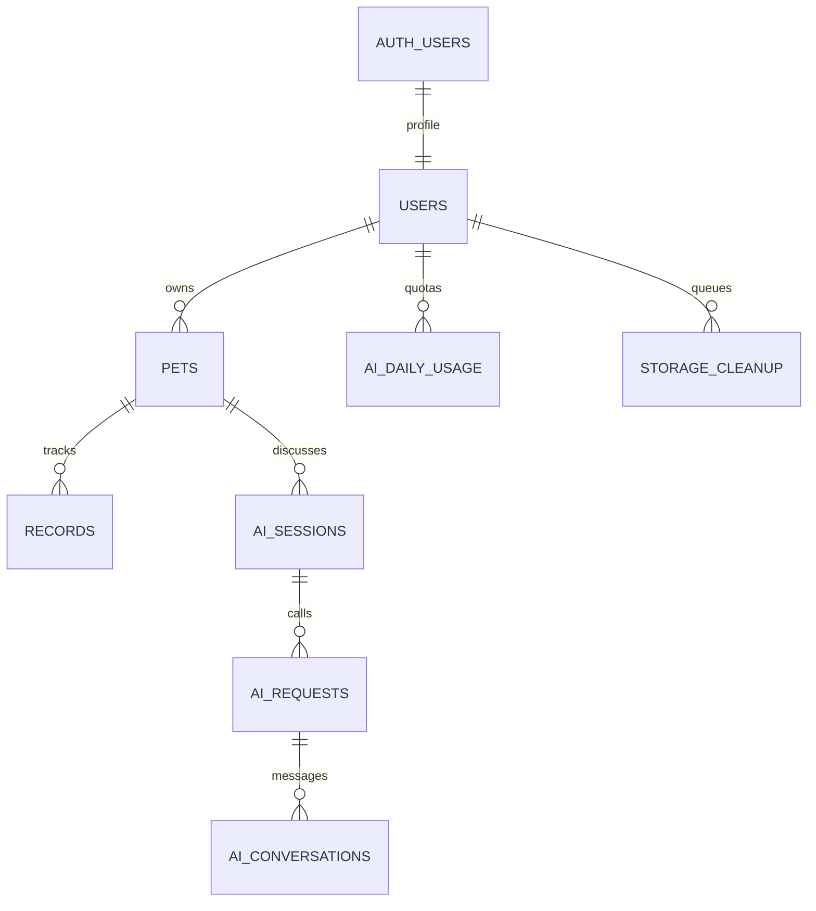

# 数据库与安全设计

迁移按文件名顺序执行，三份均已应用到 `pet-nest-dev` 开发项目，且 CLI 迁移历史与本地一致。

- `supabase/migrations/202610270001_p0.sql`：首次初始化结构，外层 `BEGIN/COMMIT` 确保失败回滚；不得对已有项目重复粘贴执行或随意重置。
- `supabase/migrations/20261027150205_harden_auto_rls_permissions.sql`：收紧平台自动创建的 `public.rls_auto_enable()` 的 EXECUTE 权限，移除 anon/authenticated/PUBLIC 调用权，保留数据库事件触发器行为。用 CLI `migration new` 生成，已通过 dry-run 后部署。
- `supabase/migrations/20261028035619_sms_hook_delivery_log.sql`：短信回调去重状态表，不保存手机号、验证码或密钥。事件唯一键防重复发送；仅 service_role 可读写。

PGlite 回归测试顺序执行全部迁移，包含短信表的权限测试。原 8 张业务表和新增 sms_deliveries 均启用 RLS；普通用户不能执行 AI 额度/完成 RPC 或读写短信状态，只有服务端角色可执行。

## 表关系



| 表               | 主要字段                                                                                                    | 完整性 / 用途                                                                |
| ---------------- | ----------------------------------------------------------------------------------------------------------- | ---------------------------------------------------------------------------- |
| auth.users       | Supabase 管理的 UUID/邮箱/认证信息                                                                          | 不在业务表存密码或重复实现认证                                               |
| users            | id、nickname、bio、avatar_path、时间戳                                                                      | id 外键关联 auth.users，注册触发器自动创建，已有用户补全                     |
| pets             | UUID、user_id、name、species、breed、gender、date_kind、birth_date、weight、sterilized、avatar_path、remark | UUID + user_id 唯一组合；每人最多 10 只；默认私有，没有公开开关              |
| records          | UUID、user_id、pet_id、type、JSONB content、image_paths、occurred_at、时间戳                                | (pet_id,user_id) 复合外键，防止把自己的记录关联他人的宠物                    |
| ai_sessions      | UUID、user_id、pet_id、时间戳                                                                               | (id,user_id,pet_id) 唯一组合，防止串会话                                     |
| ai_requests      | 请求 UUID、所属会话、问题、答案、status、error_code、model、tokens、latency_ms、时间戳                      | 一次受理请求一条调用日志；pending/succeeded/failed；同一会话至多一个 pending |
| ai_conversations | UUID、request_id、user_id、pet_id、session_id、role、content、token_used、时间戳                            | (request_id,role) 唯一，用户问题在预留时保存，AI 回答在完成事务保存          |
| ai_daily_usage   | (user_id,usage_date)、used、updated_at                                                                      | 按上海自然日，CHECK 0–20；更新事务预留计次                                   |
| storage_cleanup  | path、user_id、created_at                                                                                   | 删除/替换已关联图片时自动入队；不能直接删 storage.objects 代替删除实际文件   |
| sms_deliveries   | event_id、status、provider_code、created_at、finished_at                                                    | Auth HTTP Hook 的事件级去重和发送状态；不关联尚未提交的注册用户              |

所有业务核心表有创建/更新时间戳；计数和清理表保留与其用途相关的时间戳。没有为 P1 建立社区表。

## 六类 content 结构

| type       | content 示例                                                  |
| ---------- | ------------------------------------------------------------- |
| feeding    | `{"food":"成猫干粮","amount":40,"unit":"g"}`（g/ml）          |
| weight     | `{"weight":4.1}`（kg，0 < 数值 ≤ 1000）                       |
| deworming  | `{"kind":"both","note":"用户填写"}`（internal/external/both） |
| bath       | `{"note":"用户填写"}`                                         |
| medication | `{"name":"用户提供","dosage":"用户提供","note":""}`           |
| incident   | `{"description":"食欲较昨日下降"}`                            |

日期时间使用 timestamptz，浏览器按本地时区显示；AI 额度单独使用 Asia/Shanghai。档案日期通过 date_kind 区分出生/领养，领养日期不冒充年龄。前端 Zod 和数据库 CHECK/触发器同时验证重要字段，避免绕过 UI。

## RLS 与最小权限

- 所有业务表启用 RLS。未登录 anon 无业务表权限。
- users 仅本人 SELECT/UPDATE，只能更新 nickname/bio/avatar_path。
- pets、records 的 SELECT/INSERT/DELETE 由 `auth.uid() = user_id` 约束。宠物只授予可编辑字段的 UPDATE 权限，不能修改 ID、owner 或创建时间；记录仅允许后续关联 image_paths，避免隐式篡改既有事实。
- AI 表仅允许当前用户读取，客户端无法写入调用日志、对话或额度。对话/请求读取额外限制最近 30 天。Edge 查询即使用 service role 也显式过滤 user_id + pet_id + session_id。
- 两个 AI RPC 只授予 service_role 执行；即使知道函数名，普通用户不能自己调额度参数。所有 security definer 函数固定空 search_path，并使用完整表名。
- 服务端用 `auth.getUser(token)` 验证真实身份，不接受浏览器传 user_id；请求 schema 拒绝多余字段。

## 并发和幂等

`limit_pets` 对 users 的 owner 行加锁，再计数；不是「前端查数量后插入」。同一用户的并行插入按顺序检查。不同用户互不占用此锁。

`reserve_ai_request` 在一个事务内：锁定 owner → 验证宠物归属 → 检查请求 UUID 的原内容是否匹配 → 检查会话 → 条件更新 used < 20 → 写请求与用户消息。任一步失败，全部回滚。数据库唯一键兜底请求幂等；同 UUID 不能更换问题/宠物/会话。

模型网络调用发生在事务外，避免长时间持锁。`finish_ai_request` 锁定请求，仅 pending 可完成，一次事务写状态/统计/回答。崩溃留下的 pending 超过 2 分钟后，可被同会话的**新请求**标记失败；已占额度不退。原 ID 用于查询/安全重试，不会再次调用模型。

PGlite 能验证 SQL 事务、权限、约束和 25 次排队预留的上限，但其连接在同一引擎排队，**不能证明多连接并发锁行为**。另已在真实 Supabase 完成 12 次宠物创建、25 次额度预留的多连接并发验收，见 TEST-RESULTS.md。

## 存储和删除

私有 bucket：`pet-media`，5 MiB 文件上限，允许 image/jpeg、image/png、image/webp。普通用户不能 UPDATE 对象，只能用随机新路径上传。前端还检查文件头。

```text
<user UUID>/profile/<random UUID>.jpg
<user UUID>/pets/<pet UUID>/avatar/<random UUID>.png
<user UUID>/pets/<pet UUID>/records/<record UUID>/<random UUID>.webp
```

Storage INSERT 策略同时验证目录 user、真实宠物归属、异常记录归属和文件路径格式。SELECT/DELETE 只能访问自己的用户目录，删除策略保留已删除实体的路径访问权限以支持善后。签名链接最长 5 分钟刷新一次，页面每 4 分钟自动续签。

删除宠物使用 ON DELETE CASCADE 清理记录和 AI 数据；触发器把关联路径写入 storage_cleanup。Edge cleanup 先验证当前用户，再通过 Storage API 删除自己的队列文件，成功后移除队列项。网络失败保留队列，登录、上传替换、删除操作和设置页可重试。

长期无人登录的队列、上传后立即断网产生的未关联文件以及账户被管理员删除后的队列，需要运维定期核查清理；本版未配置无凭据的云端定时任务，见已知问题。
