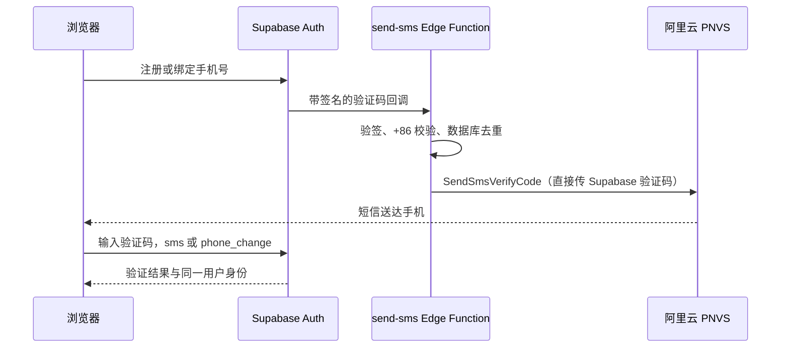

# +86 手机号、绑定与阿里云短信认证

核对日期：2026-10-28。当前用户使用的是「号码认证服务 PNVS → 短信认证」，不是普通「短信服务 SMS」。二者的接口、签名、模板、套餐不通用。

## 当前实现和验证范围

- 登录/注册及个人中心的手机号输入固定显示 +86，只接受中国大陆 11 位手机号。
- 手机号注册通过 Supabase signUp 提交，收到真实验证码后用 verifyOtp(type=sms) 完成；请求失败不会展示“已发送”。
- 已登录用户用 updateUser 申请绑定手机号，收到验证码后以 phone_change 验证。绑定邮箱通过 updateUser 发送确认链接，邮件确认前保持待验证。两种方式都更新当前 Auth 用户，不创建新业务账号，不合并其他用户数据。
- 个人中心读取服务端 getUser 的确认状态；邮件返回或窗口重新获得焦点时检查，提供手动刷新入口。手机变更后的身份 ID 与原账号不一致时拒绝继续并清除本地会话。
- 绑定页面直接显示短信验证码输入框；发送后刷新状态即使未返回 new_phone 也不会丢失本次待验证号码/已填验证码。刷新已有账号状态时不隐藏表单；重新打开后可填写同一手机号和已收到的验证码继续验证，无需强制重发。手机号改变会清空旧验证码，绑定结果仍以服务端验证为准。手机号注册页另提供“已有验证码，继续验证”入口。
- Send SMS Hook、签名验证、去重迁移已部署；RAM AccessKey 经只读 STS 调用核验，7 项短信服务端配置已上传，Auth Hook 已启用。用户确认阿里云调试调用可用；本代理没有发送真实短信，应用收件/绑定闭环尚待验证。不得将本地注入传输测试记成短信送达验收。

2026-10-28 更新：用户在验证码输入框修复后反馈“测试通过”。这是用户验收结果，代理未采集真实短信回执。随后已发布 https://pet-nest-mobile.pages.dev，手机可用现有账号继续测试。下面的云端拦截/本地注入测试仍只按原验证范围记录，不冒充真实收件。

## 在哪里获取配置

| 本机变量                        | 取得方式                                                                                                 |
| ------------------------------- | -------------------------------------------------------------------------------------------------------- |
| ALIBABA_CLOUD_ACCESS_KEY_ID     | RAM 访问控制 → 用户 → 为后端专用 RAM 用户创建 AccessKey，保存显示的 ID                                   |
| ALIBABA_CLOUD_ACCESS_KEY_SECRET | 创建 AccessKey 时保存 Secret；不要发送到聊天、截图或仓库                                                 |
| ALIYUN_SMS_SIGN_NAME            | 号码认证控制台 → 短信认证 → 赠送签名配置，复制已启用签名名称                                             |
| ALIYUN_SMS_TEMPLATE_CODE        | 同产品 → 赠送模板配置，选择配套的验证码模板，复制数字编号，例如 100001；不能使用 SMS_ 开头的普通短信模板 |
| ALIYUN_SMS_TEMPLATE_PARAM_NAME  | 模板中代表验证码的变量名，通常为 code                                                                    |
| ALIYUN_SMS_TEMPLATE_PARAMS_JSON | 模板中其他变量的 JSON，当前 `{"min":"5"}`，与云端 OTP 五分钟有效期一致                                   |
| SEND_SMS_HOOK_SECRET            | 本机已生成并设置到服务端和 Auth Hook；不是阿里云 AccessKey，不在配置文件或文档写真实值                   |

填写已经创建的 `supabase/.env.sms.local`。例子在 `.env.sms.example`，只有占位符；不要覆盖已有本地配置。纯短信 API 接入无需融合认证 AppID/SchemeCode；SchemeName 不填使用默认方案。

最小 RAM 自定义权限示例（仅发送接口）：

```json
{
  "Version": "1",
  "Statement": [{ "Effect": "Allow", "Action": "dypns:SendSmsVerifyCode", "Resource": "*" }]
}
```

请由用户本人在阿里云完成 RAM 用户/AccessKey 创建和授权。本项目不要求主账号 AccessKey，也不要求控制台管理全部云资源的权限。

官方依据：[个人开发者接入](https://help.aliyun.com/zh/pnvs/use-cases/sms-verify-for-individual-developers)、[新手指引](https://help.aliyun.com/zh/pnvs/getting-started/sms-authentication-service-novice-guide)、[API 权限](https://help.aliyun.com/zh/pnvs/developer-reference/api-dypnsapi-2017-05-25-ram)。

## 发送与验证码归属



调用 endpoint 为 dypnsapi.aliyuncs.com，Action 为 SendSmsVerifyCode，版本 2017-05-25。直接传入 Supabase 的验证码，不使用 `##code##` 让阿里另生成一套；因此验证码由 Supabase 校验，不调用 CheckSmsVerifyCode。该模式由[发送 API 文档](https://help.aliyun.com/en/pnvs/developer-reference/api-dypnsapi-2017-05-25-sendsmsverifycode)明确支持。

已通过 CLI 将 Supabase 手机 OTP 设为 6 位、300 秒，模板 min=5、发送参数 ValidTime=300 与其一致。控制台表单要求填写不适用的 Twilio 凭据，已取消未保存修改，改用经过源码核对的 CLI 配置字段 otp_length/otp_expiry；没有填写假提供商。重发由前端倒计时和 Auth 服务端 60 秒频控限制。模板或有效期变更时，须同步修改实际 Auth 配置、模板参数和发送参数。

### CLI 确认开关的实际转换与回归

当前 CLI 固定为 2.122.0。其[字段转换源码](https://github.com/supabase/cli/blob/HEAD/packages/config/src/project-config/registry-auth.ts)将 auth.sms.enable_confirmations 直接映射为 sms_autoconfirm，字段说明却写“启用验证”。实际云端测试发现 true 会自动确认换绑手机号。因此本项目填写 false，并通过公开 Auth `/settings` 验证 phone_autoconfirm=false，真实验证码要求才生效。升级 CLI 时必须重新核对，不能按字段名称反改。

运行 `npm.cmd run check:auth` 可检查云端 email/phone 均启用且 mailer_autoconfirm/phone_autoconfirm 均为 false，不会发短信或邮件。这个联网检查独立于 104 项本地测试；本地 SDK mock 无法证明云端配置正确。另已通过真实测试账号请求保留虚构的非中国大陆号码，验证 Auth → Hook 返回拒绝且账号不变，无阿里云发送。之前定位配置问题时 A 的虚构号码曾自动变更，已恢复原号码，没有修改 Test_01。

send-sms 仅接受 Standard Webhooks 验签通过的请求，时间窗口由官方库校验；不接受浏览器传入号码直接群发。新版本回调以 sms.phone 作为实际发送目标，兼容字段仅作回退，避免手机号变更时发给原号码。只有 Code=OK 且 Success=true 才认定上游受理，不能把 HTTP 200 当成短信已送达。

sms_deliveries 用唯一事件 ID 防重复发送，普通用户不可读写。只记录状态/错误码/时间，不记录手机号、验证码或密钥；网络超时视为结果未知，不自动再次发送同一回调，避免重复费用。真实送达以手机收件及阿里云回执为准。

## 已执行配置与后续验收

1. 已从用户指定的本机文件导入 RAM AccessKey；已排除该文件的 Git 跟踪。用户截图提供签名和模板并确认调试调用可用，已写入本机配置。
2. 已生成 Hook 签名密钥，使用 CLI Secrets 将 7 项本地变量设到服务端。真实值没有作为命令参数或终端输出。
3. 三份迁移历史一致；send-sms 已部署。Auth Hook 指向开发函数 URL 并注入同一签名密钥，手机号和邮箱验证保持开启。
4. Auth 发送间隔已设为 60 秒。首次应用收件验收请由用户用自己拥有的号码操作，验证注册、绑定、重发、错误码和同一用户 ID。
5. 在真实手机接收验证完成前，不声明应用短信闭环已联调成功。保留邮箱登录入口。旧 A/B 的 +44 虚构号码不适用当前 +86 页面，请用它们的邮箱登录。

云端补测通过：GET 返回 405；未签名请求返回 401；正确 HMAC 签名的非中国大陆号码在上游调用前返回 400；匿名读取短信状态表返回 401/42501。报告保存在本机忽略的 test-results/cloud-sms-guard.json 和 auth-sms-hook-guard.json，不包含真实手机号/验证码/密钥。用户已报告阿里云调试调用可用，但本项目尚未执行真实手机收件，不将这些拦截测试写成短信送达通过。

Supabase 的 [Send SMS Hook](https://supabase.com/docs/guides/auth/auth-hooks/send-sms-hook) 在 [Free/Pro 套餐均可用](https://supabase.com/docs/guides/auth/auth-hooks)，第三方短信费用独立计费。

## 免费额度查询结论

此前查询到阿里普通短信服务有 [100/200 条免费测试包](https://help.aliyun.com/zh/sms/product-overview/billing-overview)，腾讯云首次开通 [个人 100 / 企业 500 条](https://cloud.tencent.com/document/product/382/13444/)，但腾讯个人账号的国内签名仍涉及企业资质/授权。普通短信测试包不能抵扣本项目正在选择的 PNVS 短信认证费用。

PNVS 面向个人开发者提供系统签名/模板，免自行申请企业短信签名；这不代表短信发送永久免费。请在号码认证控制台查看本产品的余额、套餐和当前活动资格，不能把其他产品的免费额度当作已到账。参考[产品区别](https://help.aliyun.com/zh/sms/product-overview/selection-guide-for-short-message-service-and-sms-verification-service)与[套餐隔离说明](https://help.aliyun.com/zh/pnvs/use-cases/sms-verify-for-individual-developers)。本次未领取额度、购买套餐或承诺自动续费。
